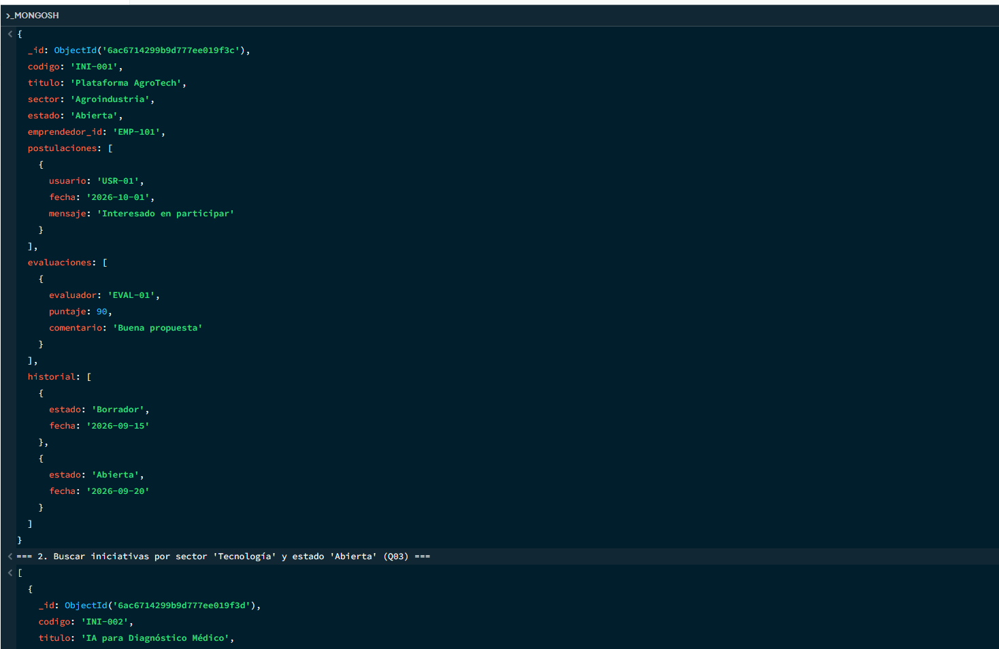

# Evidencias de Ejecución del Entorno MongoDB

## 1. Verificación de MongoDB Shell (mongosh)
Se ejecutó el script `01_explorar.js` que realiza las operaciones CRUD básicas y las consultas de prueba sobre la colección `iniciativas`.

### Captura de Ejecución:

## 2. Salida de Consultas Realizadas
- **Q01**: Detalle de la iniciativa `INI-001` retornado correctamente con sus arreglos de postulaciones y evaluaciones.
- **Q03**: Filtro por sector "Tecnología" y estado "Abierta" retornando el documento correspondiente.
- **Q06**: Agregación `$group` agrupando las iniciativas por sector y contando los totales.