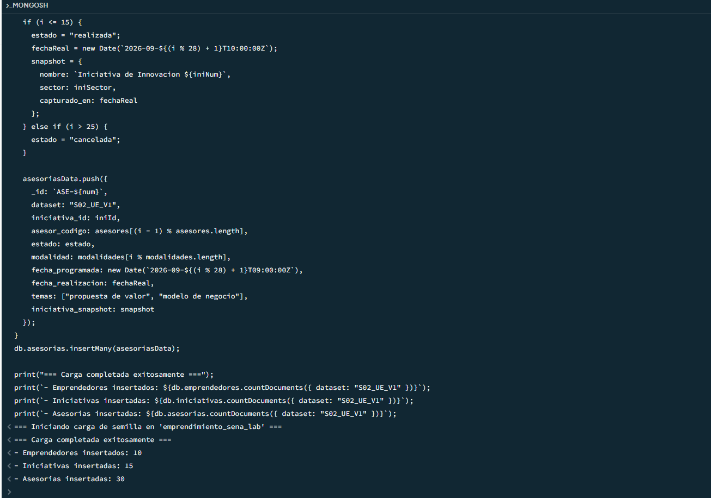
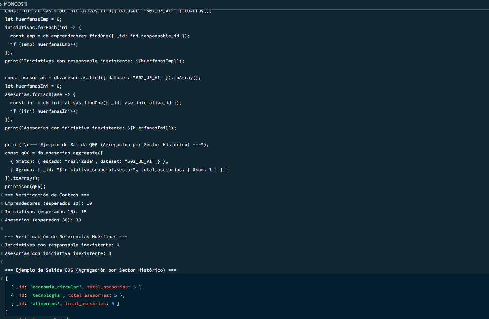

# Evidencias de Carga y Verificación del Modelo v1 (Semana 2)

## 1. Carga de Semilla Reproducible
Se ejecutó el script `02_cargar_semilla.js` sobre la base de datos `emprendimiento_sena_lab`, poblando con éxito el conjunto de datos `S02_UE_V1`.

- **Emprendedores creados:** 10
- **Iniciativas creadas:** 15
- **Asesorías creadas:** 30 (15 realizadas, 10 programadas, 5 canceladas)

### Captura de Carga de Semilla:

---

## 2. Verificación de Integridad Referencial y Consultas
Se ejecutó el script `03_verificar.js` comprobando los contratos del modelo v1:

- **Referencias Huérfanas:** 0 entre iniciativas y emprendedores; 0 entre asesorías e iniciativas.
- **Consulta Q06 (Agregación Histórica):** Agrupación correcta por `iniciativa_snapshot.sector` (5 por sector).

### Captura de Verificación:
