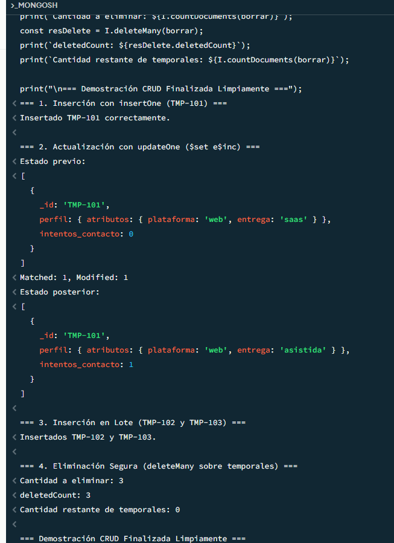
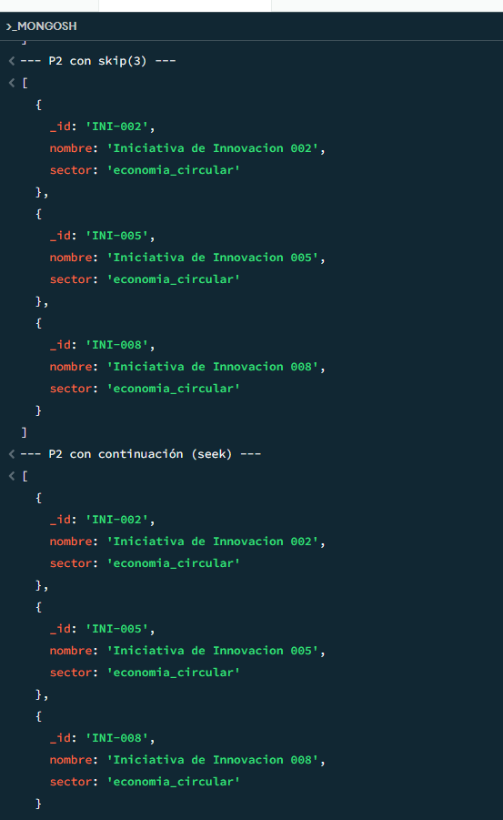

# Evidencias de Ejecución Semana 3 - CRUD y Consultas Reproducibles

## 1. Operaciones CRUD Seguras
Se ejecutó el script `02_demo_crud.js` sobre documentos temporales (`TMP-*`) sin alterar la semilla original S03_UE_V1.

## 2. Catálogo de Consultas Reproducibles (C01 - C10)
Se ejecutaron exitosamente las 10 consultas en `03_consultas_aprendiz.js`, validando operadores lógicos, arreglos, distinción entre `null` y ausencia, `$elemMatch` y métodos de paginación (skip vs seek).

